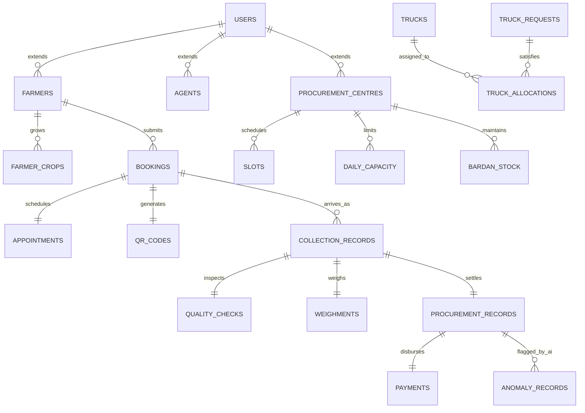

# BharatAgri Iteration 3 — Complete Database Schema & Data Inventory

This document details the complete 58-table relational schema discovered in the authoritative MySQL production database (`bharatagri_iteration2`) and the SQL schema reference (`database/bharatagri_iteration2.sql`).

> **CRITICAL PRESERVATION DIRECTIVE**
> The database containing actual records operates externally and independently from the Git repository. Under no circumstances should automated startup routines, migrations, or deployment scripts run `DROP TABLE`, `TRUNCATE TABLE`, `DELETE FROM`, or overwrite existing records.

---

## 1. Verified Production Table Inventory & Record Counts

The live MySQL database `bharatagri_iteration2` contains **58 tables** and **thousands of active application records**:

| # | Table Name | Verified Records | Primary Purpose | Key Foreign Keys / Relationships |
|---|------------|------------------|-----------------|----------------------------------|
| 1 | `roles` | 4 | User roles (Farmer, Agent, Centre, Government) | Referenced by `users.role_id` |
| 2 | `users` | 5,052 | System login credentials, password hashes, and statuses | `roles(id)` |
| 3 | `states` | 4 | Master administrative states | Referenced by `districts` |
| 4 | `districts` | 10 | Master administrative districts | `states(id)` |
| 5 | `blocks` | 49 | Sub-district administrative blocks | `districts(id)` |
| 6 | `villages` | 0 | Master village registry (optional hierarchy) | `blocks(id)` |
| 7 | `farmers` | 5,011 | Farmer profiles, contact info, land area, e-KYC | `users(id)` |
| 8 | `farmer_crops` | 5,545 | Crops grown per farmer, acreage, estimated yield | `farmers(id)`, `crop_metadata` |
| 9 | `agents` | 42 | Field agent profiles, operating blocks | `users(id)` |
| 10 | `agent_farmer_assignments` | 448 | Agent-to-farmer support links and jurisdiction | `agents(id)`, `farmers(id)` |
| 11 | `procurement_centres` | 32 | Centre registration, address, geo-coordinates, capacity | `users(id)`, `blocks(id)` |
| 12 | `daily_capacity` | 1,432 | Per-date operational capacity limits (quintals) | `procurement_centres(id)` |
| 13 | `non_operational_dates` | 6 | Centre holidays and maintenance dates | `procurement_centres(id)` |
| 14 | `slots` | 8,828 | Hourly/daily appointment slots per centre | `procurement_centres(id)` |
| 15 | `bookings` | 19,046 | Crop booking requests, quantities, appointments | `farmers(id)`, `centres(id)`, `slots(id)` |
| 16 | `appointments` | 18,930 | Direct appointment schedules linked to bookings | `bookings(id)` |
| 17 | `booking_status_history` | 18 | Audit trail of booking transitions | `bookings(id)`, `users(id)` |
| 18 | `qr_codes` | 10,212 | Cryptographic QR tokens generated for appointment passes | `bookings(id)` |
| 19 | `collection_records` | 9,705 | Produce arrival and gate intake records | `bookings(id)`, `centres(id)` |
| 20 | `quality_checks` | 9,038 | Produce quality grading results (Grade A/B/C/Reject) | `collection_records(id)` |
| 21 | `weighments` | 9,003 | Gross, tare, and net weighment scale records | `collection_records(id)` |
| 22 | `procurement_records` | 9,641 | Final procurement receipts, total amounts, settlement | `collection_records(id)` |
| 23 | `procurement_transactions`| 9,668 | Transaction ledger for procurement actions | `procurement_records(id)` |
| 24 | `storage_lots` | 3 | Warehouse batch and lot allocation records | `procurement_records(id)` |
| 25 | `payments` | 9,669 | Direct Benefit Transfer (DBT) payment disbursements | `procurement_records(id)`, `farmers(id)` |
| 26 | `trucks` | 54 | Registered transport fleet, vehicle numbers, capacities | Independent master |
| 27 | `truck_requests` | 24 | Logistics requests from congested centres | `procurement_centres(id)` |
| 28 | `truck_allocations` | 73 | Optimization-assigned vehicle dispatches | `truck_requests(id)`, `trucks(id)` |
| 29 | `truck_route_predictions` | 72 | Predicted transit durations and fuel metrics | `truck_allocations(id)` |
| 30 | `truck_route_approvals` | 18 | Administrative dispatch authorization workflow | `truck_allocations(id)` |
| 31 | `truck_collection_routes` | 0 | Multi-centre collection route sequences | `truck_allocations(id)` |
| 32 | `inventory` | 100 | Current warehouse crop stock levels | `procurement_centres(id)` |
| 33 | `inventory_transactions` | 0 | Stock intake and dispatch audit records | `inventory(id)` |
| 34 | `bardan_stock` | 25 | Jute / gunny bag inventory per centre | `procurement_centres(id)` |
| 35 | `bardan_forecasts` | 25 | AI forecast for gunny bag requirements | `procurement_centres(id)` |
| 36 | `complaints` | 42 | Farmer and agent grievance redressal tickets | `users(id)` |
| 37 | `complaint_messages` | 16 | Message thread responses within grievance tickets | `complaints(id)`, `users(id)` |
| 38 | `complaint_status_history`| 16 | Grievance resolution status audit trail | `complaints(id)` |
| 39 | `supply_forecasts` | 0 | Machine learning crop yield forecast records | `districts(id)` |
| 40 | `centre_congestions` | 25 | Real-time traffic and capacity congestion index | `procurement_centres(id)` |
| 41 | `anomaly_records` | 47 | Flagged suspicious weighment/quality transactions | `procurement_records(id)` |
| 42 | `ai_model_metrics` | 3 | ML model evaluation scores (RMSE, R², Precision) | Independent telemetry |
| 43 | `audit_logs` | 1,539 | System-wide operational and security event logs | `users(id)` |
| 44 | `msp_prices` | 22 | Government Minimum Support Price (MSP) schedule | Independent master |
| 45 | `state_crop_supply_demand`| 9 | Macro-level state supply vs demand metrics | `states(id)` |
| 46 | `price_estimates` | 123 | Real-time procurement price estimations | `farmers(id)`, `procurement_centres(id)` |
| 47 | `procurement_evidence` | 58 | Photographic evidence metadata (produce, scale, slips) | `collection_records(id)` |
| 48 | `crop_metadata` | 19 | Supported crop specifications, moisture thresholds | Independent master |
| 49 | `alerts` | 36 | Operational warning banners and stock alerts | `users(id)`, `centres(id)` |
| 50 | `centre_daily_metrics` | 1,006 | Daily aggregated throughput per centre | `procurement_centres(id)` |
| 51 | `notifications` | 20,002| SMS and in-app alert notifications sent to users | `users(id)` |
| 52 | `process_audit_logs` | 392 | State machine step audit entries | `procurement_records(id)` |
| 53 | `process_step_corrections`| 51 | Supervisor correction records for intake errors | `procurement_records(id)` |
| 54 | `procurement_process_steps`| 895 | Multi-step gate-to-godown validation workflow state | `collection_records(id)` |
| 55 | `queue_events` | 20,092| Physical queue arrival, service, and wait time logs | `procurement_centres(id)` |
| 56 | `employees` | 163 | Centre staff and weighing scale operators | `procurement_centres(id)` |
| 57 | `ai_quality_inspections` | 101 | Computer vision mango and crop quality scan sessions | `collection_records(id)` |
| 58 | `ai_inspection_detections` | 360 | Individual bounding box and defect detection results | `ai_quality_inspections(id)` |

---

## 2. Core Functional Relationships



---

## 3. Safe External Database Setup (New Environments Only)

If you are connecting BharatAgri-3 to a brand-new cloud database instance (e.g., Aiven MySQL, TiDB Cloud, or AWS RDS):

1. **Verify the database is empty before executing any scripts**:
   ```sql
   SELECT table_name FROM information_schema.tables WHERE table_schema = 'bharatagri_iteration2';
   ```
2. **If and only if the database is confirmed to be completely blank**:
   ```bash
   mysql -h <host> -P <port> -u <user> -p bharatagri_iteration2 < database/bharatagri_iteration2.sql
   ```
3. **NEVER run this command against an active database with records.**
