# BharatAgri Iteration 3 — Architecture & System Design

BharatAgri Iteration 3 is a comprehensive agricultural procurement intelligence and supply chain management platform designed for the Indian agricultural procurement ecosystem (supporting MSP operations, direct farm-gate procurement, decentralized centre scheduling, and fraud detection).

---

## 1. System Architecture Overview

```mermaid
graph TB
    subgraph Clients["Frontend Layer (Vite + React 18 SPA)"]
        UI_Farmer["Farmer Portal (#farmer-dashboard)"]
        UI_Agent["Agent Portal (#agent-dashboard)"]
        UI_Centre["Centre Operator (#centre-dashboard)"]
        UI_Gov["Government Admin (#government-dashboard)"]
    end

    subgraph Gateway["Application & Security Boundary (FastAPI)"]
        CORS["CORS & Origin Filtering"]
        AuthMiddleware["JWT Bearer Authentication & RBAC"]
        Router["Uniform API Router (/api)"]
        StaticServer["Built Static SPA Server (Fallback)"]
    end

    subgraph CoreServices["Backend Application Layer"]
        ProcurementEngine["Procurement State Machine (6-Step Gate-to-Godown)"]
        SlotManager["Appointment & Slot Capacity Allocator"]
        QRService["Cryptographic QR Generation & Verification"]
        PaymentEngine["Direct Benefit Transfer (DBT) Ledger"]
        CopilotEngine["Government & Centre AI Copilot"]
    end

    subgraph AIML["Artificial Intelligence & Operations Research"]
        XGB_Supply["XGBoost Supply Forecaster"]
        IForest_Anomaly["Isolation Forest Anomaly Detector"]
        ORTools_Truck["Google OR-Tools Logistics Optimizer"]
        XGB_Price["XGBoost Dynamic Price Estimator"]
        GB_Queue["Gradient Boosting Queue Engine"]
        Mango_Vision["CIELAB Color & Defect Quality Classifier"]
    end

    subgraph DataLayer["Persistence & Storage Layer"]
        MySQL[("Authoritative MySQL 8 / MariaDB\n58 Tables | 5,000+ Users")]
        FileStorage["Secure Uploads (/uploads/evidence)"]
    end

    Clients -->|HTTP / REST + Bearer JWT| Gateway
    Gateway --> CoreServices
    CoreServices --> AIML
    CoreServices --> DataLayer
    AIML -.->|Read Pre-Trained Models| DataLayer
```

---

## 2. Implemented Role-Based Workflows

### 1. Farmer (`role: farmer`)
- **Registration & Authentication**: Secure sign-up with mobile number, village, and BCrypt-hashed password.
- **Profile & Land Holdings**: Registration of owned land, cultivation area, and crop declarations (`farmer_crops`).
- **Slot Booking**: Real-time discovery of operational procurement centres, available dates, and hourly appointment slots.
- **QR Digital Pass**: Instant generation of unique QR tokens (`BA-QR-<appointment_id>`) encoding farmer identity, appointment schedule, declared crop, and estimated quantity.
- **Live Status & Payment History**: Tracking produce from gate intake to weighment, quality certification, and DBT payment disbursement.

### 2. Field Agent (`role: agent`)
- **Assigned Farmer Support**: Assists registered farmers within their jurisdiction with booking slots and updating produce estimates.
- **Proxy Bookings**: Submits appointments on behalf of marginal or illiterate farmers.
- **Grievance Support**: Raises and monitors complaints on behalf of farmers.

### 3. Procurement Centre Operator (`role: centre`)
- **Centre Administration**: Configures daily capacity limits, operating hours, and non-operational dates/holidays.
- **QR Verification & Gate Intake**: Scans farmer QR pass using camera or token lookup to validate arrival.
- **6-Step Procurement Workflow**:
  1. *Gate In*: Farmer arrival registration and vehicle entry.
  2. *Quality Inspection*: Moisture check, visual defect analysis, and optional AI mango scanner.
  3. *Gross Weighment*: Weighbridge recording with digital scale verification.
  4. *Tare Weighment & Net Weight Calculation*: Net produce calculation.
  5. *Storage Lot Assignment*: Warehouse stack, godown room, and gunny bag (`bardan`) assignment.
  6. *Payment Receipt Generation*: Final procurement slip issuance triggering DBT ledger entry.
- **Inventory & Logistics**: Monitors jute bag (`bardan`) inventory and requests logistics trucks when storage threshold is exceeded.

### 4. Government / Administrator (`role: government` / `admin`)
- **Macro Dashboards & KPIs**: State-wide, district-wide, and centre-level procurement volumes vs MSP targets.
- **Anomaly Investigation**: Real-time review of transactions flagged by Isolation Forest (unusual yields, weight mismatches, moisture anomalies).
- **Logistics Dispatch Optimization**: Evaluates and approves truck allocation routes computed via Google OR-Tools.
- **Natural Language Copilot**: Answers complex procurement intelligence queries with parameterized SQL generation and guardrails.

---

## 3. Implemented AI/ML & Optimization Modules

| Module Name | Underlying Algorithm | Pre-trained Model File | Primary Features / Inputs | Real-World Business Function |
|-------------|----------------------|------------------------|---------------------------|------------------------------|
| **Supply Forecaster** | XGBoost Regressor | `ml/models/supply_forecast_xgb.joblib` | District, crop, rainfall index, historical arrivals, month | Forecasts crop arrival surges to prevent centre congestion. |
| **Anomaly Detector** | Isolation Forest | `ml/models/anomaly_detector_iforest.joblib` | Land area, claimed quantity, moisture %, grade score, processing duration | Detects illicit middleman dumping and fraudulent scale weighments. |
| **Truck Optimizer** | Google OR-Tools CVRP | Solved deterministically at runtime | Centre backlog, truck capacities, road distance matrix | Optimizes vehicle dispatch routes to minimize fuel and empty runs. |
| **Price Engine** | XGBoost Regressor | `ml/models/price_estimation_xgb.joblib` | MSP base price, quality grade, moisture deviation, market arrivals | Computes fair quality-adjusted payout per quintal. |
| **Queue Estimator** | Gradient Boosting Regressor | `ml/models/queue_wait_model.joblib` | Active gate arrivals, operating scales, crop type, hour of day | Predicts wait time at the centre to smooth out daily farmer arrivals. |
| **Mango AI Scanner**| CIELAB + Decision Tree | `ml/models/mango/mango-quality-v1.joblib` | Mean L\*, a\*, b\* color metrics, surface defect ratio | Automates export-grade classification for mango consignments. |

---

## 4. Security & Compliance Architecture

- **Password Hashing**: BCrypt (`passlib[bcrypt]`) with salt rounds >= 12.
- **Token Authorization**: Stateless JWT tokens signed with HS256 and parameterized expiration.
- **Role Isolation**: Strict FastAPI dependency guards (`get_current_user`, role assertions). Cross-centre data leakage is strictly prevented via tenant filtering (`procurement_centre_id`).
- **Database Sanitization**: SQLAlchemy ORM and parameterized SQL queries protect against SQL injection vulnerabilities across all endpoints.
